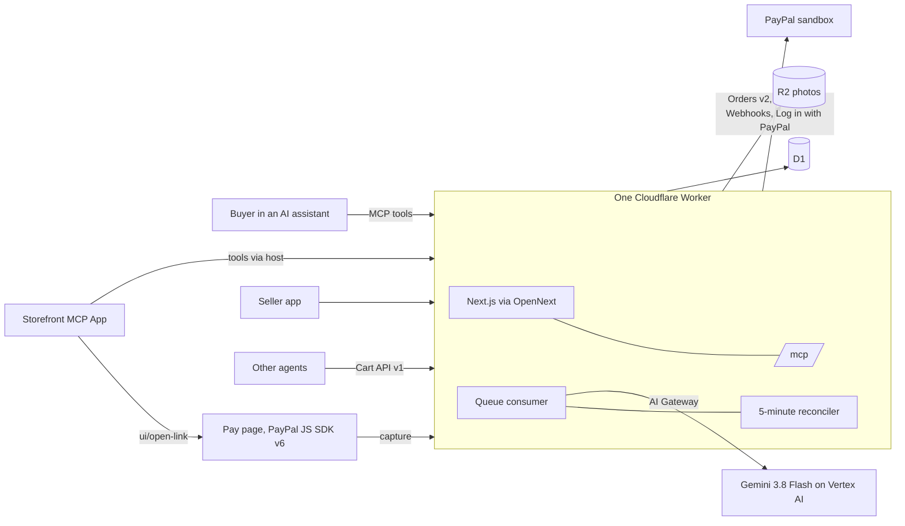

# Shelf

**Shop and pay with PayPal inside AI assistants.**

Shelf is the PayPal checkout that lives inside the chat. A buyer asks an AI assistant for something, finds a small seller's product in an interactive Storefront that renders in the conversation, picks a variant and pays with PayPal. A seller gets on Shelf by sending phone photos: Shelf Agent (Gemini 3.8 Flash on Vertex AI) drafts each product, and the seller sets every price.

Built for the [PayPal AI Hackathon](https://paypalaihackathon.devpost.com/), November 2026. Everything runs on the PayPal **sandbox**: no real money moves.

## Try it in five minutes

| Step | What to do | What you should see |
| --- | --- | --- |
| 1 | Open the [Try page](https://shelf.160422733171.workers.dev/try) and ask for something, or tap an example. | The real Storefront in a chat-style page, with products from stores real sellers published. |
| 2 | Tap a product, pick an option, **Add to cart**, change the quantity. | The server reprices the cart on every change; the total and shipping come from stored prices only. |
| 3 | Tap **Pay with PayPal**. Approve in the PayPal sandbox with the buyer login shown at the top of the Try page, or the one in the Devpost testing instructions. | The card says "Waiting for PayPal", then turns to **Paid** on its own (it polls `get_order_status`). |
| 4 | Ask for a refund from the paid order card. | "Waiting for the seller". No tool, agent or model can approve a refund; only the seller can. |
| 5 | Open the [Seller app](https://shelf.160422733171.workers.dev/app) and log in with a PayPal sandbox business account. | Name a store, add photos, check drafts, set prices, publish. Orders, tracking and refund decisions live here. |
| 6 | On a laptop, open the [Seller desk](https://shelf.160422733171.workers.dev/desk). | Every product option and every paid order in two AG Grid grids; price and stock edit in place. |

In your own assistant: add `https://shelf.160422733171.workers.dev/mcp` as a custom connector (Claude) or an app in developer mode (ChatGPT), then ask for something a Shelf seller sells, for example "laddu under $20".

## Where it works

| Surface | Works in |
| --- | --- |
| The Storefront app (cards, cart, checkout, Paid) | Assistants that support MCP Apps, such as Claude and ChatGPT. |
| The Shelf tools: `search_products`, `show_product`, `update_cart`, `start_checkout`, `get_order_status`, `request_refund` | Any assistant that connects to a remote MCP server. Each tool also answers in plain text. |
| WhatsApp | Buyers search, pick and get a PayPal Pay link; sellers send photos, set prices and publish (ADR-012). |
| The Cart API (`/api/stores/{slug}/merchant-cart`) | Any agent that can make HTTP calls, with a store key from the Seller app. Shapes follow PayPal's Cart API v1 contract. |
| The Seller desk (`/desk`) | A laptop browser: product options and orders in AG Grid (ADR-013). |

## How PayPal and AI are used

| Tool | What it does in Shelf |
| --- | --- |
| PayPal Orders v2 | Creates one order per checkout from server-priced carts, with the seller as payee, and captures it after approval. |
| PayPal Payments v2 | Captures and refunds. A refund runs only after the seller approves it, never above the captured amount. |
| PayPal JavaScript SDK v6 | The Pay page where the buyer approves. The Storefront opens it with `ui/open-link`. |
| PayPal Webhooks | Signature-checked with verify-webhook-signature, then treated as a hint: Shelf reads the order from PayPal and applies that. |
| Log in with PayPal | Sellers sign in with the PayPal account that receives their sales. |
| `PayPal-Request-Id` | Every write carries a key built from Shelf's records, so a retry acts once. |
| PayPal Cart API v1 contract | The `merchant-cart` routes for other agents. |
| Shelf Agent: Gemini 3.8 Flash on Vertex AI, through Cloudflare AI Gateway | Reads product photos and drafts title, description, options and a suggested price range; runs the WhatsApp agent with function calling over the same MCP tools. It never sets a price, approves a refund or holds a token. |
| Model Context Protocol and MCP Apps | Six tools and the interactive Storefront that renders in the conversation. |

## Sponsor tools

- **AG Grid** (Community 36.2.0, `AllCommunityModule`, React wrapper): the Seller desk at `/desk` shows every product option and every paid order in two grids. Price and stock edit in place through the same server API as the Seller app, so the server checks every change (INV-03). The grid takes Shelf's design tokens through `themeQuartz.withParams`, so it follows the theme switch and dark mode. The quick filter searches products and orders at once. See [ADR-013](docs/engineering/adr/013-seller-desk.md).

## How it works



The rules that keep money safe, each with a test:

- **The server sets every amount.** Prices come from stored variants; a `price` sent by a client is ignored (INV-01).
- **Every PayPal write carries a `PayPal-Request-Id` built from Shelf's own records** (`order:{cart}:v{n}`, `capture:{order}`, `refund:{request}`), so a retry acts once.
- **Checkout runs in phases around the PayPal call.** A crash between creating the PayPal order and recording it is repaired by the next call with the same key.
- **Webhooks are hints.** After PayPal's signature check, Shelf reads the order from PayPal and applies that truth through the same function the 5-minute reconciler uses.
- **Only the seller approves a refund**, in two taps; the amount never exceeds what was captured.
- **No implicit state machines.** Product, cart, order and refund states move only through explicit transition tables ([code quality rules](docs/engineering/code-quality.md)).

Stack: Next.js 16.4 and React 19.3 on Cloudflare Workers (one Worker via OpenNext), MCP over stateless Streamable HTTP with `@modelcontextprotocol/ext-apps`, D1, R2, Queues, Cron, PayPal REST (Orders v2, Payments, Webhooks, Log in with PayPal) and JS SDK v6, Gemini 3.8 Flash on Vertex AI through Cloudflare AI Gateway.

## Verified and not verified

What has been proven, and how. Updated as each live check runs.

| Claim | Status | Evidence |
| --- | --- | --- |
| Cart pricing, state machines, idempotency keys, signed tokens | Verified, automated | `pnpm check`: 185 tests, typecheck, schema check, test-case traceability and a secret scan, in CI on every push |
| D1 adapters run their real SQL (guarded batches, unique indexes) | Verified, automated | Tests run on Node's SQLite with the real migration (`tests/support/d1.ts`) |
| MCP surface: tools, `_meta`, MIME, no `connectDomains` | Verified, automated and live | TC-MCP-01; `tools/list` on the deployed Worker |
| Storefront views and the Paid moment | Verified in a browser | Hosted through `AppBridge` on the Try page; order views with fixture tool results |
| Seller app screens | Verified in a browser, locally | Walked at 390 px: store, photos, failed read, Fill in yourself, publish guard, store key |
| PayPal sandbox credentials on the Worker | Verified live | `/api/health` gets an OAuth token |
| Log in with PayPal redirect | Verified live | `/api/auth/paypal/start` redirects with the scopes and a `state` cookie |
| An unsigned webhook changes nothing | Verified live | 400 before any PayPal call |
| A full sandbox payment, approval to Paid | Verified live | 11 Nov: a sandbox buyer paid $19.00 (laddu, 12-pack, plus $5 shipping) to the Alcooz store; the order reads Captured. 12 Nov: three more payments of $23.00 from the Try page, recorded in the demo video |
| A buyer's refund request reaches the seller | Verified live | 12 Nov: requested from the Paid card; the order shows Refund requested, Waiting for the seller |
| Log in with PayPal round trip | Verified live | A sandbox business seller signed in; Shelf stored its payer ID. The app's own owner account cannot sign in as a seller, by design |
| PayPal webhook delivery | **Not yet verified live** | Webhook ID is set; waiting for the first real event |
| Photo to draft with Gemini | Verified live | Four real product photos became drafts through Gemini 3.8 Flash on Vertex AI; the seller set every price |
| WhatsApp agent (buyers and sellers) | **Being verified live** | Webhook verified by Meta; signature and verify-token checks answer 401 and 403 live |
| Cart API with a live key | **Not yet verified live** | `scripts/cart_agent.mjs` is ready |

## Known limits

- Sandbox only. R1 refunds are full refunds.
- One store per seller; USD only; flat shipping per order.
- Web Push is not built: the Orders screen polls every 5 seconds.
- No mock data: the Try page shows only what real sellers published.

## Run it locally

```bash
pnpm install
cp .dev.vars.example .dev.vars          # fill in sandbox values
pnpm wrangler d1 migrations apply shelf --local
pnpm build:worker && pnpm wrangler dev
pnpm check                              # types, tests, schema
```

## Documents

Product: [Concept](docs/product/00-concept.md) · [PRD](docs/product/02-PRD.md) · [SyRS](docs/product/03-SyRS.md). The business requirements and founder decisions are kept private.

Engineering: [conventions](docs/engineering/README.md) · [product](docs/engineering/01-product-contract.md) · [domain](docs/engineering/02-domain-contract.md) · [architecture](docs/engineering/03-architecture-contract.md) · [ADRs](docs/engineering/adr/) · [data](docs/engineering/04-data-contract.md) · [interfaces](docs/engineering/05-interface-contract.md) · [quality](docs/engineering/06-quality-contract.md) · [implementation](docs/engineering/07-implementation-contract.md) · [code quality](docs/engineering/code-quality.md) · [progress](docs/engineering/PROGRESS.md)

Design: [design system](docs/design/DESIGN-SYSTEM.md) · [brand](docs/design/BRAND.md)

## License

MIT. See [LICENSE](LICENSE).
