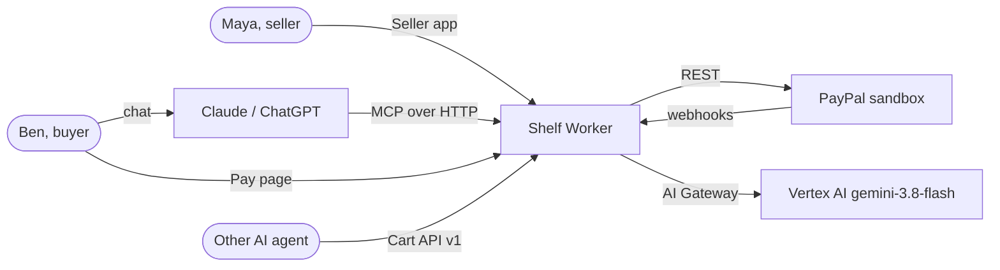
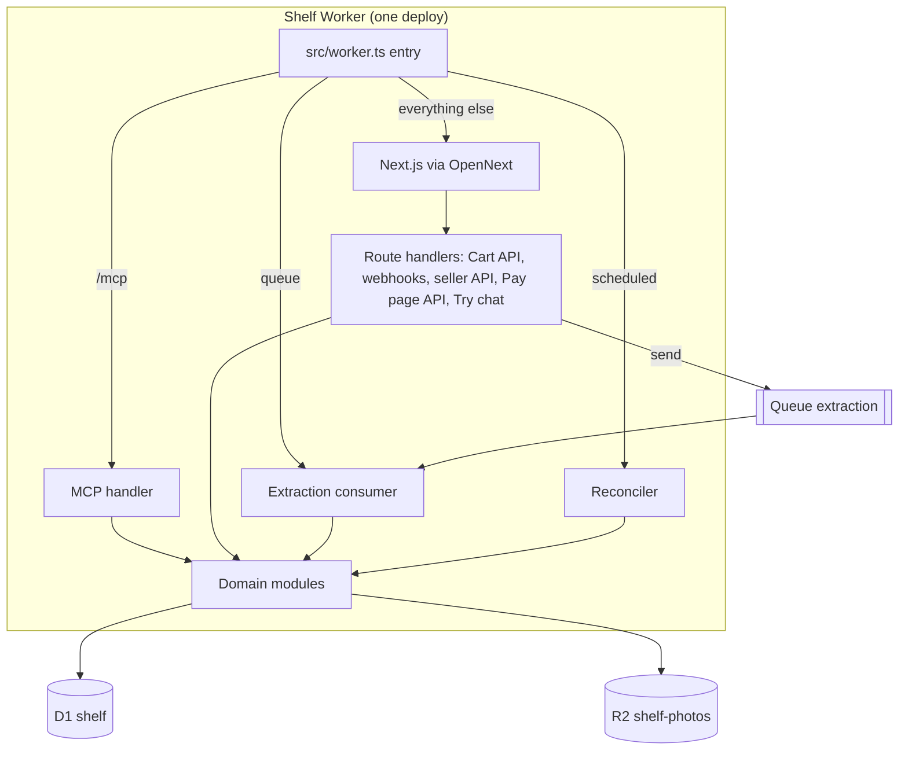
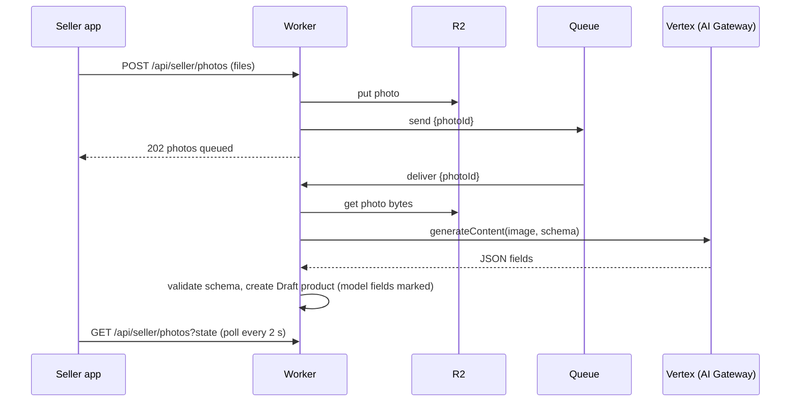
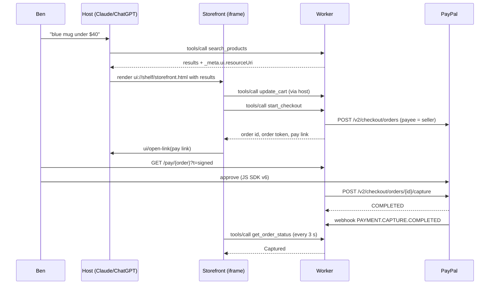

# Gate 3 · Architecture contract

> **What this is.** How Shelf is built: the containers, the code layout, the main sequences, the threat model and the cost. Each choice has an ADR in `adr/`.
>
> **Why it comes here.** Gates 1 and 2 say what and in which words. This gate says where each piece runs and why. Data (Gate 4) and interfaces (Gate 5) follow from it.
>
> **Shelf example.** The founder asked for one Worker for frontend and backend (C-5). So the MCP endpoint, the Cart API, the webhook route, the queue consumer and the Next.js pages all ship in one Worker (ADR-001).
>
> **What it produces.** The context and container views, the stack with exact versions, the code layout, four sequences, the threat model and the cost.

## Context and containers

> **What this is.** The C4 context view (Shelf and the outside systems) and the container view (what runs inside Shelf).
>
> **Why it comes here.** Every later section places its parts in this picture.
>
> **Shelf example.** Ben's Claude talks to `/mcp`. PayPal talks to `/api/webhooks/paypal`. Both enter the same Worker.
>
> **What it produces.** Two diagrams and the route table.





| Path | Handler | Who calls it |
| --- | --- | --- |
| `/mcp` | MCP handler (stateless, Streamable HTTP) | Hosts, the Try page |
| `/` | Landing | Everyone |
| `/try` | Try page | Judges |
| `/pay/[order]` | Pay page | Buyers |
| `/app/*` | Seller app | Sellers |
| `/s/[slug]` | Public store page (plain list, for links and search engines) | Everyone |
| `/api/auth/paypal/*` | Log in with PayPal start and return | Sellers |
| `/api/seller/*` | Seller app API | Seller app |
| `/api/pay/*` | Pay page API (create session, capture) | Pay page |
| `/api/stores/[slug]/merchant-cart*` | Cart API v1 | Agents |
| `/api/webhooks/paypal` | PayPal webhooks | PayPal |
| `/api/try/chat` | Try page chat (Gemini with the Shelf tools) | Try page |
| `/photos/[key]` | Signed photo read from R2 | Storefront, Seller app |

## Stack

> **What this is.** Every package and service, with the exact version range and the reason.
>
> **Why it comes here.** An agent must not pick versions. A wrong Next.js minor breaks the Cloudflare adapter.
>
> **Shelf example.** `next` is pinned to `>=16.2.11 <16.3` because `@opennextjs/cloudflare@1.20` declares that peer range and 16.3 support is an open question.
>
> **What it produces.** The stack table. Versions were read on 10 Nov 2026; the lockfile is the authority after task T-01.

| Layer | Choice | Version | Why | ADR |
| --- | --- | --- | --- | --- |
| Runtime | Cloudflare Workers, Paid plan | `compatibility_date` 2026-11-01, `nodejs_compat` | Free plan has 10 ms CPU per request and a 3 MiB bundle limit. | 001 |
| Web | Next.js App Router, React 19.2, Node runtime only | `next >=16.2.11 <16.3` | Adapter peer range. No Edge runtime, no `proxy.ts`, no `cacheComponents`. | 001 |
| Adapter | `@opennextjs/cloudflare`, `wrangler` | `^1.20`, `^4` | The official path for Next.js on Workers. | 001 |
| MCP | `agents` (`createMcpHandler`), `@modelcontextprotocol/server`, `zod` | `>=0.20`, `2.3.1` exact, `^4` | Stateless MCP over Streamable HTTP. `McpAgent` is deprecated. | 002 |
| MCP UI | `@modelcontextprotocol/ext-apps` | latest 1.x at T-01 | MCP Apps resource and tool helpers; the `App` class in the Storefront. | 009 |
| Storefront build | Vite, React, `vite-plugin-singlefile` | Vite `^7` | The resource must be one HTML document. | 009 |
| Data | D1 with Drizzle ORM | `drizzle-orm`, `drizzle-kit` latest | Relational data at small scale, in Cloudflare. | 003 |
| Files | R2 bucket `shelf-photos` | — | Photos. | 003 |
| Async | Queues, queue `extraction` | — | Photo extraction with retries. | 003 |
| Schedule | Cron `*/5 * * * *` | — | Reconcile orders, expire carts. | 003 |
| Model | Vertex AI `gemini-3.8-flash` through Cloudflare AI Gateway (provider `google-vertex-ai`) | GA since 2 Sep 2026 | Founder's GCP credits; image input; JSON schema output. | 006 |
| PayPal server | REST with `fetch`: OAuth, Orders v2, Payments, Webhooks, Identity | — | The Server SDK covers only 5 endpoints. | 004 |
| PayPal client | JS SDK v6 through `@paypal/paypal-js` (`/sdk-v6`) | latest | On the Pay page only. | 004, 005 |
| Seller sign-in | Log in with PayPal (OAuth 2.0, identity userinfo) | — | The PayPal account is the payee. | 008 |
| Push | Web Push with VAPID, `web-push`-compatible signing on WebCrypto | — | Seller notifications (Should). | — |
| UI | Tailwind CSS 4, the Shelf design system tokens | `^4` | Tokens from `docs/design/`. | — |
| Tests | Vitest with `@cloudflare/vitest-pool-workers`, Playwright | latest | Tests run in the Workers runtime. | — |
| Package manager | pnpm | `^10` | One lockfile. | — |

## Code layout

> **What this is.** Where each kind of code lives in the repository.
>
> **Why it comes here.** Each task in `tasks.yaml` lists the files it touches. The layout must exist first.
>
> **Shelf example.** All PayPal calls live in `src/server/paypal/`. No other folder calls `api-m.sandbox.paypal.com`.
>
> **What it produces.** The tree and its rules.

```
shelf/
  src/
    worker.ts                 the Worker entry: fetch, queue, scheduled
    app/                      Next.js App Router pages and route handlers
      (marketing)/page.tsx    landing
      try/                    Try page
      pay/[order]/            Pay page
      app/                    Seller app
      s/[slug]/               public store page
      api/...                 route handlers (see Gate 5)
    server/
      domain/                 pure rules: cart totals, state machines, invariants (no I/O)
      db/                     Drizzle schema and queries
      paypal/                 PayPal REST client (the only PayPal caller)
      model/                  Vertex client and extraction schema (the only model caller)
      mcp/                    MCP server: tools and the Storefront resource
      cartapi/                Cart API v1 handlers
      auth/                   seller session, Log in with PayPal, store keys, signed tokens
      push/                   Web Push
    components/               React components built from the design system
  storefront/                 the Storefront (Vite app built to one HTML file)
  db/migrations/              SQL migrations for D1
  api/                        openapi.yaml, mcp-tools.md, error-codes.yaml
  tests/                      unit, contract, e2e
  docs/                       product, engineering, design
  wrangler.jsonc, open-next.config.ts, next.config.ts
```

Rules:
1. `server/domain/` has no I/O. Every money rule lives there and has unit tests.
2. Only `server/paypal/` calls PayPal. Only `server/model/` calls Vertex.
3. The MCP tools and the Cart API call the same domain functions. There is one cart implementation.

## Sequences

> **What this is.** The four flows that cross containers, step by step.
>
> **Why it comes here.** Most bugs hide in the order of steps across systems. These diagrams fix the order.
>
> **Shelf example.** In the buyer sequence, capture happens on the server after the Pay page reports approval. The webhook then confirms it. Either can arrive first; both are safe (INV-04, INV-08).
>
> **What it produces.** Four sequence diagrams.

### Seller adds products from photos



### Buyer pays in the chat



### Webhook

1. Read the raw body and the PayPal transmission headers.
2. Call `POST /v1/notifications/verify-webhook-signature` with the headers, the body and `PAYPAL_WEBHOOK_ID`.
3. If not `SUCCESS`, answer 400 and change nothing.
4. Insert the event ID into `webhook_events`. If it exists, answer 200 and change nothing (INV-08).
5. Apply the transition from SM-ORD or SM-RFD, and write one Event (INV-09).
6. Answer 200.

### Refund

1. Ben calls `request_refund`. Shelf creates a Pending request and an Event, and sends Web Push to Maya.
2. Maya taps Approve, then Refund. Shelf sets Approved and calls `POST /v2/payments/captures/{capture}/refund` with `PayPal-Request-Id` = refund request ID.
3. On COMPLETED (answer or webhook `PAYMENT.CAPTURE.REFUNDED`), Shelf sets Done and the Order Refunded.

## Threat model

> **What this is.** What can go wrong on purpose or by mistake, and the control for each threat.
>
> **Why it comes here.** Shelf moves money and runs model output. Controls must be designed in, not added after the demo.
>
> **Shelf example.** THR-04: a product photo holds text that tells the model to set the price to zero. Control: the schema has no field the model can use to publish, and every price needs the seller.
>
> **What it produces.** THR-01 to THR-10.

| ID | Threat | Control | Test |
| --- | --- | --- | --- |
| THR-01 | A buyer or agent sends a lower price. | INV-01: server totals only. | TC-PAY-02 |
| THR-02 | A forged webhook marks an order Paid. | Verify with PayPal before any change (SYS-PAY-04). | TC-PAY-04 |
| THR-03 | A replayed webhook or double click captures twice. | `PayPal-Request-Id`, unique webhook IDs, INV-04. | TC-PAY-03 |
| THR-04 | Prompt injection in a photo changes price or publishes. | Schema output only; seller confirms price; no publish from model (SYS-AI-02, SYS-AI-05). | TC-AI-03 |
| THR-05 | Prompt injection in a chat makes the model refund. | No refund tool exists; `request_refund` makes Pending only (INV-05). | TC-SEC-03 |
| THR-06 | A guessed order ID leaks a buyer's address. | Order token required; tools return no address to the model. | TC-SEC-02 |
| THR-07 | A seller reads another store's orders. | Store ownership check on every seller route (INV-10). | TC-SEC-01 |
| THR-08 | A leaked Pay page link is reused. | HMAC-signed, 30-minute expiry, bound to one order (NFR-SEC-02). | TC-SEC-02 |
| THR-09 | The MCP endpoint is abused for load. | Host allow list, per-address rate limit, Cloudflare WAF rule. | TC-MCP-06 |
| THR-10 | A secret leaks through logs or the Storefront. | Secrets in Worker secrets only; log redaction; check script. | TC-SEC-04 |

## Environments and secrets

> **What this is.** Where Shelf runs and which secrets each place holds.
>
> **Why it comes here.** The first deploy needs these names. A wrong name fails at run time, not build time.
>
> **Shelf example.** The judges' URL is the `sandbox` environment. There is no production PayPal in R1.
>
> **What it produces.** The environment table and the secret list.

| Environment | Worker | PayPal | Purpose |
| --- | --- | --- | --- |
| local | `wrangler dev`, local D1 | sandbox | Development |
| preview | Worker version per pull request | sandbox | Review |
| sandbox | `shelf` on `*.workers.dev` | sandbox | Judges, video |

Secrets (set with `wrangler secret put`): `PAYPAL_CLIENT_ID`, `PAYPAL_CLIENT_SECRET`, `PAYPAL_WEBHOOK_ID`, `CF_AIG_TOKEN` (AI Gateway token), `SESSION_SECRET`, `TOKEN_SECRET`, `VAPID_PUBLIC_KEY`, `VAPID_PRIVATE_KEY`. Variables: `PAYPAL_BASE=https://api-m.sandbox.paypal.com`, `GCP_PROJECT`, `GCP_LOCATION=global`, `CF_ACCOUNT_ID`, `AIG_NAME=shelf`, `PUBLIC_ORIGIN`.

## Cost

> **What this is.** What R1 costs to run until judging ends.
>
> **Why it comes here.** C-3 says the demo stays free for judges until 15 Dec 2026. We must know what keeps it up.
>
> **Shelf example.** One photo extraction uses about 1,500 input tokens and 400 output tokens (estimate). At $0.75 and $3.75 per million, 1,000 photos cost about $2.60.
>
> **What it produces.** The cost table (estimates).

| Item | R1 cost (estimate) |
| --- | --- |
| Workers Paid | $5 a month |
| D1, R2, Queues | Inside the Paid plan free amounts at R1 volume |
| Gemini 3.8 Flash | Under $5 until 31 Dec 2026 at the introductory price; the price doubles on 1 Jan 2027 |
| PayPal sandbox | $0 |

## The principle to remember

One Worker, one cart implementation, one PayPal caller, one model caller, and a person at every money step.
